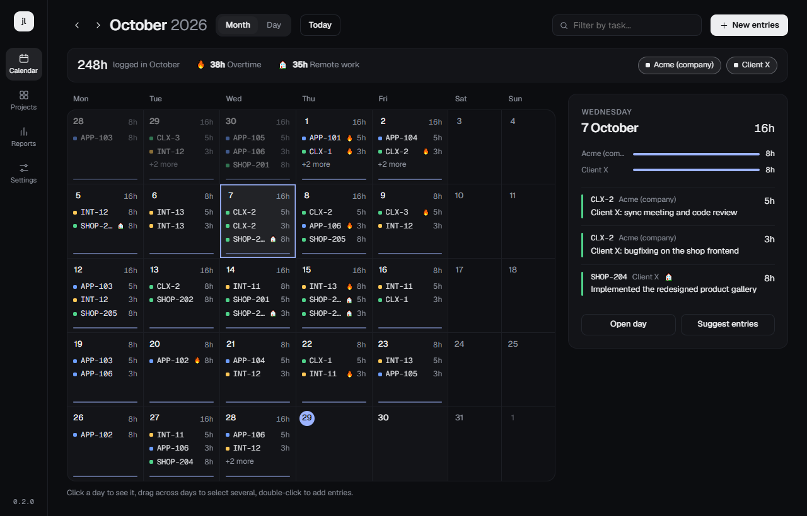
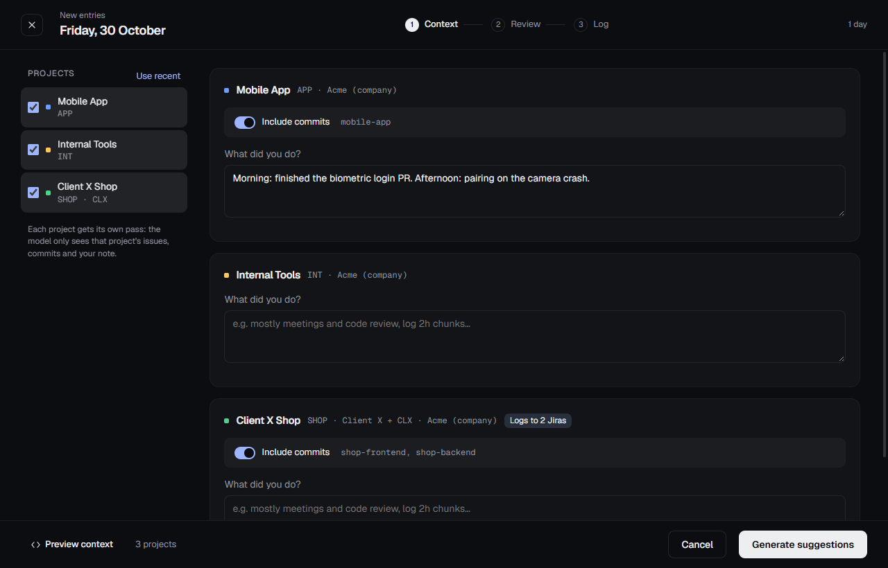
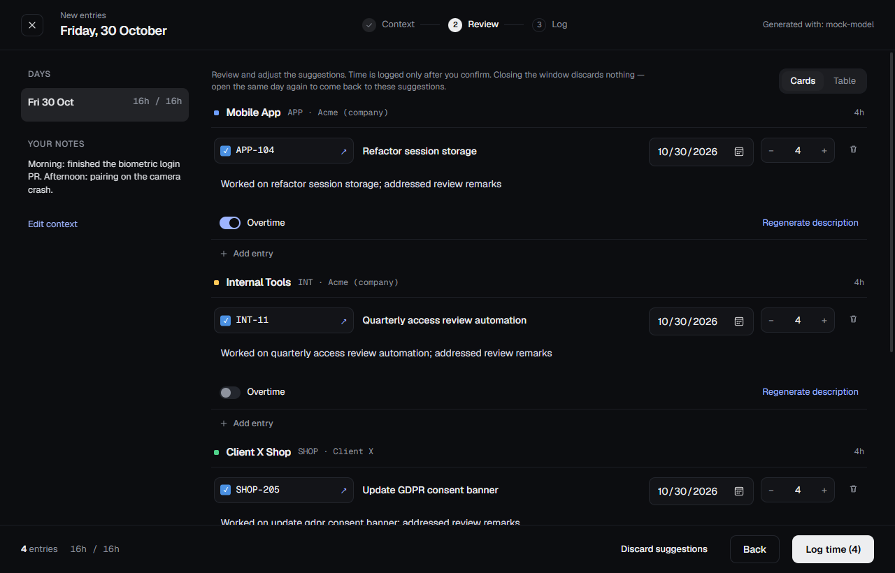

<div align="center">

# Jira Auto Logger

**Log your Jira / Tempo time from what you actually did.** Your git commits and a line of notes go in, ready-to-review worklogs come out.

[](https://github.com/doctorspider42/jira-auto-logger/releases/latest)
[](https://github.com/doctorspider42/jira-auto-logger/actions/workflows/release.yml)




</div>

## Why

Filling in Tempo at the end of the day (or month) means reconstructing what you did from memory. The facts are already somewhere: in your commits, your branches, the issues you touched. Jira Auto Logger reads them, asks an LLM of your choice to draft the worklogs in **your own style**, and lets you review every entry before anything is sent to Tempo.

- **Grounded, not invented.** The model may only pick issues that really exist in your Jira; anything else is thrown away.
- **Isolated per project.** Each project gets its own pass with only its issues, commits and notes - nothing leaks between clients.
- **You stay in charge.** Nothing is logged until you confirm. Unsubmitted suggestions wait for you if you close the window.

## How it works

1. The **calendar** shows your Tempo worklogs from every active Jira, tinted by project. Each day has a progress bar towards your working day; empty workdays are flagged, and the month summary offers to fill them in one go.
2. Pick a day (or drag across several) and choose **New entries**. Tick the projects you worked on, keep or drop their commits, and add a note.

   

3. Each project - and each Jira it logs to - gets an **isolated LLM pass**. Your recent worklogs are the style guide, so suggestions read the way you write them.
4. **Review**: one compact row per entry - issue (searchable picker with type badges), date, hours, description, custom fields. Rewrite a description with a hint, then log everything in one click.

   

## Features

| | |
|---|---|
| **Several Jiras** | Your company's Jira and a client's, each with its own Tempo token. A project can log the same work into both; the day view shows one lane per Jira ([screenshot](screenshots/calendar-day.png)). |
| **Projects** | A project pins Jira projects (each with its own standing LLM instruction), git repositories with a per-repo author filter, and a calendar colour ([screenshot](screenshots/projects.png)). |
| **LLM backends** | Claude CLI, GitHub Copilot CLI or the OpenAI API (or any compatible endpoint), with model choice and a thinking on/off switch. Expired Claude sessions are detected and the login flow opens from the app. |
| **Custom fields** | Tempo work attributes (yes/no or text), imported from the API or added by hand, optionally filled by the LLM and marked in the calendar with an icon. |
| **PDF reports** | Tempo-style monthly summaries or detailed timesheets: filters, up to five grouping levels (custom fields included), columns, time format, orientation, accent and a filename template such as `{MM}.{YYYY}.pdf` ([screenshot](screenshots/reports.png)). |
| **Auto logger** | At a set time on weekdays: just remind you, open the day with suggestions ready, or generate and log the day on its own. Existing hours are respected. |
| **Desktop** | Launch at sign-in, minimize to the tray, native window backdrop (Mica on Windows 11, Acrylic on Windows 10, vibrancy on macOS). |
| **Twelve themes** | Graphite and Paper by default, plus iteo, Classic 95, Vault Terminal, New Vegas, Memory Card, Hello Kitty, Y2K Chrome, Clair Obscur, Animus and a hidden one. Each changes palette, type, shape and backdrop - never the layout. |
| **Debug tools** | Preview the exact prompt (with a token estimate) before sending, and a diagnostic log file ([screenshot](screenshots/settings.png)). |
| **Private by design** | Tokens are encrypted with the OS (DPAPI on Windows). Only commit messages are read, never the code. Telemetry is anonymous counts only and can be turned off. |

## Install

Download the installer for your system from the [latest release](https://github.com/doctorspider42/jira-auto-logger/releases/latest): `*-setup.exe` (Windows), `.dmg` (macOS) or `.AppImage` (Linux). The app updates itself on every platform.

> The macOS app is signed with a Developer ID and notarized by Apple, so it opens without warnings. The Windows and Linux installers are not code-signed, so Windows SmartScreen will ask you to confirm the first launch.

Coming from an older (Electron) version? It updates itself into this one and keeps your settings.

## Configuration

- **Jira + Tempo connections** (Settings) - the instance URL (`https://company.atlassian.net`), your account e-mail, an [Atlassian API token](https://id.atlassian.com/manage-profile/security/api-tokens) (classic, no scopes) and a Tempo API token (Tempo → Settings → API Integration, `Worklogs: Manage`). Both token pages open from the app.
- **Projects** - name, Jira project(s), repository folders, commit author, colour, standing instructions.
- **AI model** - provider, model, thinking switch, how many recent issues the model may choose from, and your own extra instructions.
- **Automation** - auto logger mode and time, launch at sign-in, tray.
- **PDF reports** - output folder, filename template, defaults, end-of-month reminder.

## Development

```bash
npm install
npm run dev          # Vite + the Rust backend in debug mode
npm run dev:mock     # the same on fake data - no tokens, no network
npm run typecheck    # TypeScript
npm run test:rust    # backend tests
npm run build        # installer for this OS
npm run screenshots  # regenerate the images in this README (Windows, after `npx tauri build --no-bundle`)
```

Requirements: Node 22+, a stable Rust toolchain, and on Linux the WebKitGTK build libraries (`libwebkit2gtk-4.1-dev libappindicator3-dev librsvg2-dev patchelf`).

**Mock mode** (`npm run dev:mock`, `JAL_MOCK=1` or `--mock`) runs everything on deterministic fake data: two connections, three projects, six weeks of Tempo history, fake commits and a fake LLM with a realistic delay. Your real config is never read or written and nothing goes over the network.

## Architecture

```
src-tauri/        Rust backend - all logic
  commands.rs     one command per window.api method
  config.rs       settings, migrations, encrypted tokens (secrets.rs)
  services/       Jira, Tempo, git, per-connection clients
  llm/            prompt building, response validation, Claude / Copilot / OpenAI
  reports/        report HTML printed to PDF by the system webview
  auto_logger.rs, updates.rs, telemetry.rs, desktop.rs, mock/
src/shared/       the command contract (ipc.ts) and domain types
src/renderer/     React UI: calendar, new entries, projects, reports, settings,
                  themes (tokens -> CSS variables), i18n (Polish/English)
```

The interface never talks to external services: every call goes to a Rust command and comes back as a `Result`, so every error reaches the screen as a translated message. Jira, Tempo, git and the LLM sit behind traits, which is also how mock mode plugs in.

Dependencies are MIT, Apache-2.0 or OFL (fonts) licensed - no copyleft.
