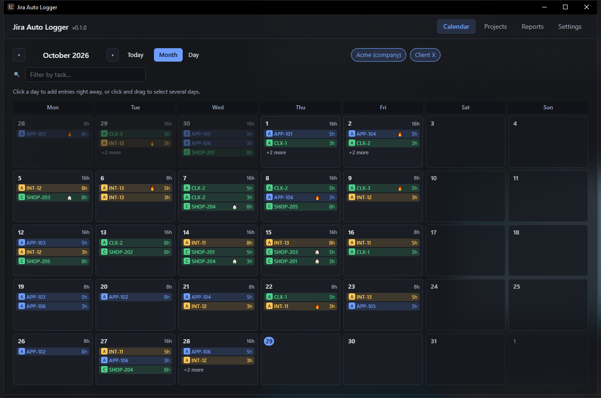

# Tauri trial

A spike to see what moving from Electron to [Tauri 2](https://tauri.app) would cost and gain.
The existing React renderer runs unchanged inside a Tauri window. One feature, loading
settings, is ported to Rust. Nothing here replaces the Electron app.



## What is in it

| Piece | Where | State |
|---|---|---|
| Tauri window, bundle, icons | `src-tauri/` | Working; Windows NSIS installer |
| Loading settings | `src-tauri/src/config.rs` | Ported: reads the config.json Electron saved, merges it over the defaults, filters stale references, decrypts the tokens Electron stored with `safeStorage` (Windows: Chromium's AES-GCM key under DPAPI). Legacy shape migrations are not ported. |
| Saving settings | `src-tauri/src/main.rs` | In memory only, so the trial never overwrites Electron's config and its encrypted tokens |
| `window.api` bridge | `src/tauri-web/tauriApi.ts` | Same `IpcApi` contract. Mock mode serves Jira, Tempo and git from the existing mock clients; with real settings every other call returns "Not ported to the Tauri trial yet." |
| Transparent window | `apply_backdrop` in `main.rs`, `src/tauri-web/backdrop.css` | Mica on Windows 11, Acrylic on Windows 10, vibrancy on macOS; the page lets part of the backdrop through |

## Run it

```bash
npm run tauri:dev
npm run tauri:build
```

Pass `--mock` (or set `JAL_MOCK=1`) to run on fake data. `JAL_BACKDROP=mica|acrylic|blur|none`
forces a window effect.

## Measurements

Windows 10, mock mode, calendar open, 10 s after launch, three runs each. Memory is the sum over
the app's whole process tree (Electron's helpers, or the WebView2 processes Tauri starts).

| | Electron 43 | Tauri 2 |
|---|---|---|
| Installer | 98 MB | **1.2 MB** |
| Installed size | 380 MB | **3.3 MB** (+ WebView2, already part of Windows) |
| Processes | 4 | 7 |
| Working set | ~340 MB | ~340 MB |
| Private memory | ~228 MB | ~200 MB |

Window-appearance time is not in the table: Tauri shows its window before the page loads and
Electron after, so the numbers measure different moments.

## Findings

- **Size is the big win**: about 80× smaller to download and over 100× smaller installed.
- **Memory barely changes on Windows.** WebView2 is Chromium too, so the page costs what it costs
  in Electron. The gain is in the backend: Rust instead of a Node process.
- **The renderer ports as is.** All themes, fonts and animations, including Clair Obscur's
  particles, render the same, because Windows' WebView2 is the same engine.
- **Existing settings carry over.** Rust reads Electron's config and decrypts its tokens on
  Windows. macOS (Keychain) and Linux (libsecret) keys still need porting.
- **To check by hand:** Acrylic on Windows 10 is known to lag while the window is resized or
  dragged; Mica (Windows 11) does not.
